  

  

  
  

## 👋🏻 Sobre mí

<table>
  <tr>
    <td width="55%" valign="middle">

- 🎓 Graduado en **Ingeniería Informática** por la **Universidad de Salamanca**.
- 💼 **Backend Developer** en [Insurea](https://github.com/albergm02).
- 🔭 Trabajando en proyectos personales para seguir aprendiendo y construyendo mi portfolio.
- 🌱 Ampliando conocimientos en desarrollo web full stack, bases de datos y arquitectura de software.
- 👯 Abierto a colaborar en proyectos open source interesantes.
- 💬 Pregúntame sobre **C/C++**, **JavaScript** o metodologías de trabajo.
- 🌐 Mi web: [albertogm.dev](https://albertogm.dev/)

  </td>
    <td width="45%" align="center" valign="middle">
      
    </td>
  </tr>
</table>

## 🛠️ Tecnologías y herramientas

  <b>💻 Sistemas operativos</b> 
  
  
  

  <b>📝 Lenguajes</b> 
  
  
  
  
  
  

  <b>🧰 Herramientas de desarrollo</b> 
  
  
  
  
  

## 📊 Estadísticas de GitHub

  
  

  

  

### 🏆 Trofeos

  

### 📌 Proyectos destacados

  
  

  
  

## 🐍 Mi calendario de contribuciones

  <picture>
    <source media="(prefers-color-scheme: dark)" srcset="https://raw.githubusercontent.com/albergm02/albergm02/output/github-snake-dark.svg"/>
    
  </picture>

## 📬 Contacto

  
  
  
  

  📫 ¿Quieres contactarme? Escríbeme a <a href="mailto:alberto.g.m.0214@gmail.com">alberto.g.m.0214@gmail.com</a>

  

